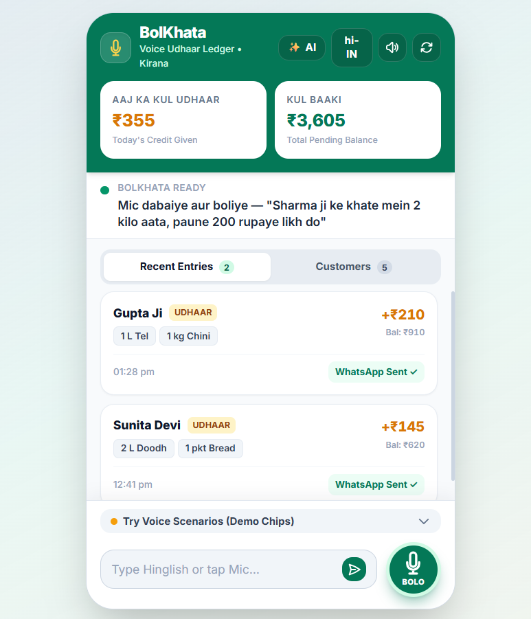

<div align="center">

# 🎙️ BolKhata
### Voice-First Udhaar Ledger for Indian Kirana Shopkeepers

[](https://hasu7.github.io/Bolkhata/)
[](#-quick-start-docker)
[](#-about-the-project)

**No typing. No tiny keyboards during rush hour. Just speak in natural Hinglish.**

---

### 📱 Meet BolKhata — Your Voice-Powered Digital Khata



</div>

---

## 💡 About the Project

**BolKhata** is a voice-first digital *udhaar* (credit) ledger built for Indian kirana shopkeepers for the **Scaler × Wispr Flow: India Runs on Voice Hackathon 2026**.

During busy store hours, shopkeepers struggle to type customer names, grocery items, and amounts on small phone screens. BolKhata lets them simply tap **Bolo** and speak naturally in Hindi or Hinglish—automatically logging entries, updating balances, tracking itemized purchases, and generating WhatsApp receipts.

---

## ✨ Key Features

- 🗣️ **Hinglish & Indian Fractions NLP:** Understands real-world Indian shop speech like *"dhai kilo chawal, paune 200 rupaye"* (`₹175`) and *"sawa 300"* (`₹325`).
- 🛡️ **Safety Confirmations:** Always confirms new customer names and every *Udhaar* (credit) or *Jama* (payment) amount before saving to prevent misheard entries.
- 👥 **Dynamic Duplicate-Name Handling:** Automatically detects shared names/surnames (e.g., *Rajesh Sharma* vs. *Anil Sharma*) and prompts to pick the right customer.
- 🧾 **Itemized Borrowed Breakdown (*Udhaar Samaan Hisaab*):** Tap any customer to view a clear itemized history of borrowed goods and totals for transparent bill settlement.
- ↩️ **Payment Settlement & 8-Second Undo:** Supports partial/full settlements (`Paid ✓` badge) and an instant 8-second voice or button undo (*"Cancel karo"*).
- 💬 **WhatsApp Receipt Preview:** Generates a ready-to-send Hindi/Hinglish receipt after every transaction.
- ⚡ **Zero-Key Offline-First + Optional AI Mode:** Runs out of the box with **zero API keys** using a local browser NLP parser, plus an optional Bring-Your-Own-Key (BYOK) **Gemini AI** toggle for complex phrasing.

---

## 🐳 Quick Start (Docker)

BolKhata starts immediately with **one command** and requires **no secret keys or environment variables**.

```bash
git clone [https://github.com/hasu7/Bolkhata.git](https://github.com/hasu7/Bolkhata.git)
cd Bolkhata
docker compose up -d
```

Open **[http://localhost:8080](http://localhost:8080)** in Chrome (or any Chromium browser).

To stop the container:
```bash
docker compose down
```

---

## 🎯 Try These Voice Commands (or Demo Chips)

| Scenario | Sample Hinglish Command |
| :--- | :--- |
| **Indian Fractions** | *"Rajesh Sharma ke khate mein dhai kilo chawal paune 200 rupaye likh do"* |
| **Ambiguous Name** | *"Sharma ji ke khate mein do kilo aata, ek litre doodh, 165 rupaye likh do"* |
| **New Customer** | *"Ramesh Verma ke khate mein 1 kilo chini, 120 rupaye likh do"* |
| **Payment Settlement** | *"Sunita Devi ne 620 rupaye jama kiye"* |
| **Daily Tally Query** | *"Aaj ka total udhaar kitna hua?"* |
| **Voice Undo** | *"Cancel karo"* |

---

## 🛠️ Tech Stack

- **Frontend:** HTML5, Tailwind CSS, Vanilla JavaScript (zero build step, mobile-first UI)
- **Voice & Audio:** Web Speech API (`hi-IN` / `en-IN`), Web Speech Synthesis (TTS), Web Audio API
- **NLP Engine:** Custom local Hinglish/Devanagari transliteration & fraction parser + optional Gemini 2.5 Flash (BYOK via `localStorage`)
- **Storage & Deployment:** Browser `localStorage`, Docker (`nginx:alpine`), GitHub Pages

---

## 👨‍💻 Authors

- **Rajiv Kumar**
- **Pankaj Kumar Jha** ([@hasu7](https://github.com/hasu7))

---

<div align="center">
  Built with ❤️ for Bharat's Kirana Stores • <b>India Runs on Voice Hackathon 2026</b>
</div>
